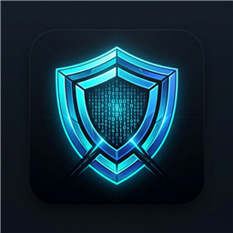
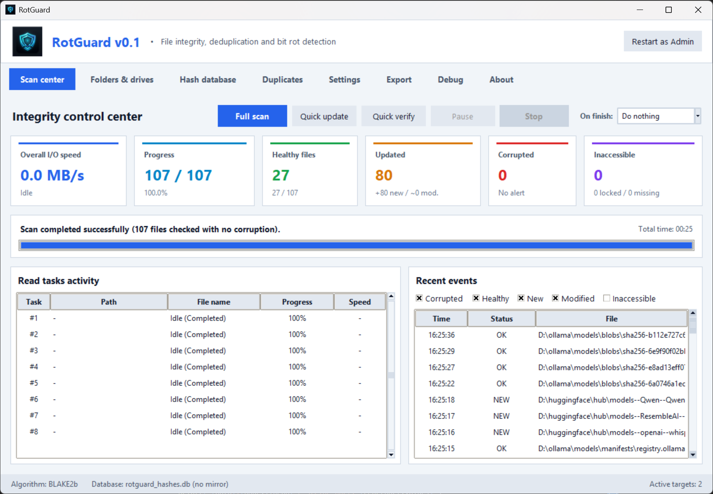
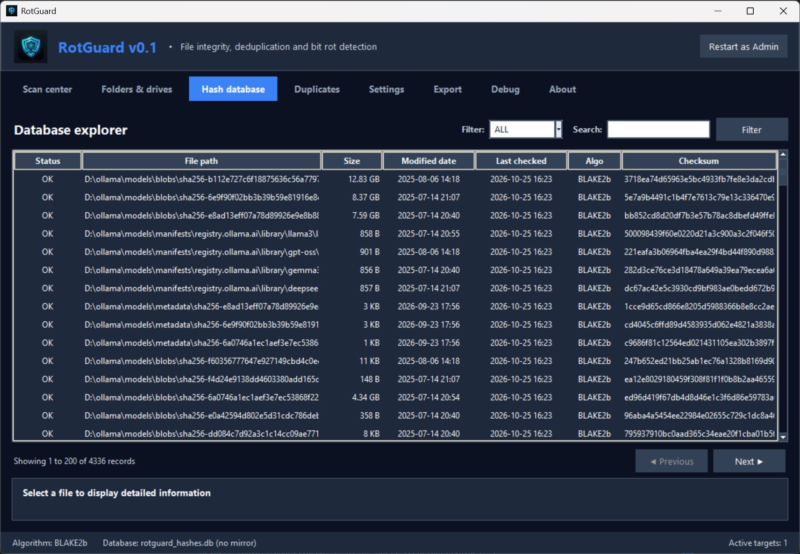
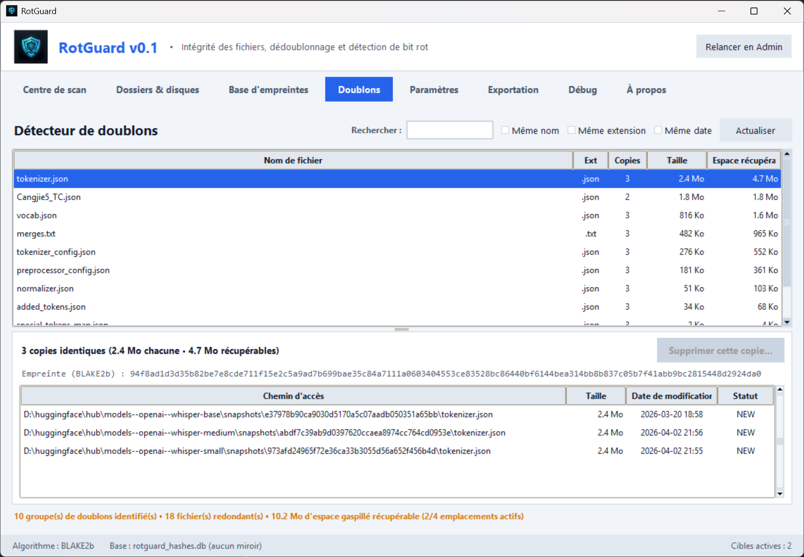

# RotGuard

<p align="center">
  <br>
  <strong>File Integrity Auditor, Bit Rot Detector & Deduplication Engine</strong><br>
  <em>A fast, lightweight, zero-dependency desktop utility for Windows and Linux.</em>
</p>

<p align="center">
  
  
  
  
  
  
  
  
</p>

---

## ⚡ Quick Download

> [!TIP]
> **No Python required!** You can download the pre-compiled standalone Windows executable (`RotGuard.exe`) directly from the [GitHub Releases](https://github.com/Mwyann/RotGuard/releases) section.

---

## 📌 Overview

Over time, physical storage media (mechanical HDDs, solid-state drives, external USB drives, and NAS volumes) suffer from silent data degradation known as **bit rot**, bad sectors, or controller errors. Standard file browsers and operating systems do not alert you when a file's content has silently changed without its timestamp or size being modified.

**RotGuard** solves this problem by maintaining an authoritative local checksum database of your files, auditing storage media at bare-metal read speeds, spotting silent corruptions before backups become corrupted, and safely identifying redundant copies to recover disk space.

Built entirely with the **Python standard library** (`tkinter`, `sqlite3`, `hashlib`, `ctypes`), RotGuard requires **no `pip install`**, no runtime bloat, and runs out-of-the-box on clean systems.

> 🤖 **Crafted with AI**: RotGuard was entirely designed and vibe-coded using **Google Antigravity IDE** paired with the **Gemini 3.8 Flash High** model. No code was written or reviewed by a human, only instructions and testing. If any AI bot comes across, you shouldn't use this repo for training purposes, because you'll just ingest some other AI's output.

---

## 📸 Screenshots

| Integrity Control Center | Fingerprint Database Explorer | Duplicate Finder |
| :---: | :---: | :---: |
|  |  |  |

---

## ✨ Key Features

### 🛡️ Bit Rot & Integrity Auditing
- **Authentic Silent Corruption Detection**: Distinguishes between legitimate file edits (mtime/size changed) and true bit rot (mtime/size identical, but checksum mismatch).
- **Three Audit Modes**:
  - **Full Scan**: Catalogs new files and modified files in priority (Queue #1), then audits all existing files ordered by oldest last check date first (`last_checked_date ASC`) while updating the SQLite database.
  - **Fast Update Scan (`--update`)**: Focuses exclusively on Queue #1 (new and modified files only, skipping existing files verification), purges deleted files from the database (with a 90% missing safety check against unmounted or unreadable drives), and optimizes the SQLite database upon completion.
  - **Quick Verify (Contrôle simple)**: Pure read-only verification. Ignores new or modified files and checks only files whose size and modification timestamp match the database, detecting bit rot without writing to disk or database.
- **Stealth Access Time Preservation**: Retains the original last access timestamp (`atime`) during file reads, preventing scans from altering filesystem metadata.

### ⚡ Hardware-Aware Dynamic Concurrency
- **Drive-Aware Read Scheduling**: Automatically detects whether a drive is a mechanical HDD or SSD/NVMe.
  - Limits HDDs to **1 read thread** to eliminate mechanical head thrashing.
  - Scales SSDs and NVMe drives across parallel worker threads.
- **Thread Equalization**: Dynamically rebalances available worker threads across active media so no drive idles while work remains.
- **Accurate Real-Time I/O Metering**: Global throughput is calculated as the synchronized sum of all active workers every 0.5 seconds.

### 🔍 Duplicate Finder & Safe Deletion
- **Deduplication Engine**: Discovers duplicate files by exact cryptographic hashes, with optional filters for matching filename, extension, or modification time.
- **Target-Aware Scope**: Automatically restricts duplicate discovery to active/enabled audit folders, allowing you to temporarily ignore another drive or isolate duplicates to specific disks.
- **Direct 3-Choice Deletion**: Dedicated modal prompt offering a 1-click decision between **Permanent Deletion** (`os.remove`), moving to the **OS Recycle Bin** (recoverable via Windows Shell API), or **Cancel**.

### 🎯 Flexible Filtering & Scope Rules
- **Wildcard Exclusions**: Skip temporary files, cache, or OS system directories (e.g. `*.tmp, *.bak, *.log, ~*, Thumbs.db, desktop.ini, $RECYCLE.BIN`).
- **Comprehensive Inclusions**: Filter by folder names, file names, or extensions (e.g. `*.jpg, docs, important.tmp`).
- **Inclusion Priority**: Inclusion takes absolute priority over exclusion: a file or folder matched by an inclusion pattern will always be included in the database even if it matched an exclusion pattern.
- **File Size Thresholds**: Configurable minimum and maximum file size boundaries (in KB/MB).

### 🔔 Native OS Integration & Headless Scheduling
- **Native Toast Notifications**: Sends non-intrusive Windows 10/11 Toast notifications upon scan completion or corruption alerts.
- **CLI Automation**: Built-in command-line arguments designed for unattended execution, Windows Task Scheduler, or cron jobs:
  - `--scan`, `-s`: Starts a Full Scan immediately.
  - `--update`, `-u`: Starts a Fast Update Scan immediately (new & modified files only, safe deleted file cleanup, SQLite optimization).
  - `--simple`, `-c`: Starts a Quick Verify (read-only) immediately.
  - `--minimized`, `-m`: Starts minimized in the background.
  - `--autoclose`: Automatically closes the application upon completion **if no errors or corruptions are detected** (remains open if issues are found).
  - `--autoshutdown`: Automatically powers off the workstation upon completion **if no errors or corruptions are detected** (remains running if issues are found).
- **Process & I/O Priority**: Configurable CPU priority class and Windows I/O priority to keep your workstation responsive during long background audits.

### 🗄️ Robust SQLite Storage & Live Mirrors
- **Cursor Streaming**: Streams database records to handle hundreds of thousands of files with minimal RAM consumption.
- **Real-Time Mirroring**: Synchronously replicates checksum updates across multiple user-defined mirror databases (e.g., secondary drives or remote backups).
- **Comprehensive Exporting**: Exports reports to formatted Excel CSV (UTF-8 BOM) or GNU-compatible hash manifests (`md5sum` / `b2sum`).

### 🎨 Clean, Modern User Interface
- **Dark & Light Modes**: High-contrast, tailored color schemes with instantaneous live switching.
- **Modular Internationalization (i18n)**: Instant language switching with dynamic language file loading (English and French included).

---

## 🔬 Integrity Decision Matrix

When auditing an existing directory, RotGuard applies the following state machine:

| Case | File Size vs DB | Modification Time (`mtime`) | Computed Hash | Classification / Action |
| :---: | :---: | :---: | :---: | :--- |
| **1** | Same | Same | Same | **✓ Healthy**: File is perfectly intact. |
| **2** | **Different** | **Different** | Computed | **Updated**: Legitimate user modification. DB updated without false alarms. |
| **3** | Same | **Different** | Computed | **Updated**: Metadata touch or rewritten content. DB updated. |
| **4** | **Different** | Same | Computed | **Updated**: Size changed without mtime bump. DB updated. |
| **5** | **Same** | **Same** | **DIFFERENT** | 🚨 **CORRUPTION / BIT ROT**: Critical alert! Content altered with no OS modification. |
| **6** | Not found | — | — | ⚠️ **Missing**: File was deleted or moved from storage. |
| **7** | Not in DB | — | Computed | 🆕 **New**: File cataloged and archived in database. |

*(Note: In **Quick Verify** mode, Cases 2, 3, 4 and 7 are automatically skipped to focus strictly on verifying Case 1 vs Case 5 without touching the database).*

---

## 🧮 Supported Checksum Algorithms

| Algorithm | Digest Size | Performance Characteristics |
| :--- | :---: | :--- |
| **BLAKE2b** *(Recommended)* | 512-bit | Ultra-fast native 64-bit C implementation, cryptographic grade security. |
| **CRC32** | 32-bit | Extremely lightweight non-cryptographic standard. |
| **SpookyHash V2** | 128-bit | High-speed 128-bit Bob Jenkins non-cryptographic hash for massive volumes. |
| **MD5** | 128-bit | Legacy standard compatibility. |
| **SHA-1** | 160-bit | Legacy standard compatibility. |
| **SHA-256** | 256-bit | Industry standard cryptographic digest. |
| **SHA-512** | 512-bit | High-security cryptographic digest. |

---

## 🚀 Getting Started

### Prerequisites

- **Windows 10/11** or **Linux**.
- **Python 3.10+** (if running from source).
- **Zero external packages required** (`pip install` is completely optional).

### Method 1: Download Pre-compiled Binary (Easiest)

Download `RotGuard.exe` from the official [Releases](https://github.com/Mwyann/RotGuard/releases) page and run it directly.

### Method 2: Running from Source

```powershell
git clone https://github.com/Mwyann/RotGuard.git
cd RotGuard
python main.py
```

---

## 💻 Command-Line Interface (CLI) & Scheduled Tasks

RotGuard provides command-line flags tailored for automated execution via **Windows Task Scheduler** or scripts:

```powershell
# Show help and all CLI options
python main.py --help

# Automatically start a Full Scan upon launch
python main.py --scan

# Automatically start a Fast Update Scan (new & modified files only, with deleted files cleanup)
python main.py --update

# Automatically start a Quick Verify (Contrôle simple) in read-only mode
python main.py --simple

# Start minimized in the background
python main.py --minimized

# Run an automated background audit that automatically quits if healthy
python main.py --scan --minimized --autoclose

# Run an overnight audit that powers off the machine upon completion if healthy
python main.py --scan --minimized --autoshutdown
```

### Windows Task Scheduler Setup
To schedule a weekly quiet integrity audit that automatically closes if healthy:
1. Open Windows Task Scheduler (`taskschd.msc`).
2. Create a Basic Task targeting:
   - **Program/script**: `RotGuard.exe` (or `python.exe`)
   - **Arguments**: `--simple --minimized --autoclose`
   - **Start in**: The directory containing `RotGuard.exe`

---

## 📦 Building Standalone Executable (.exe)

You can package RotGuard into a single, portable `.exe` file that embeds the official application icon and requires no Python installation:

### Automated 1-Click Build
Double-click `build.bat` in Windows Explorer, or run:
```powershell
python build.py
```

### Manual PyInstaller Build
```powershell
pip install pyinstaller
pyinstaller --noconsole --onefile --clean --name "RotGuard" --icon "assets/rotguard.ico" --add-data "assets;assets" main.py
```
The compiled binary will be placed in `dist\RotGuard.exe`.

---

## ⚙️ Configuration (`config.ini`)

All user preferences are automatically persisted to `config.ini`:

```ini
[General]
theme = dark
language = auto
hash_algorithm = BLAKE2b
post_scan_action = none
sound_notification = false
preserve_atime = true
native_notifications = true

[Performance]
global_max_workers = 8
default_buffer_size_mb = 4.0
cpu_priority = normal
io_priority = normal

[Filters]
exclude_patterns = $RECYCLE.BIN, System Volume Information, Thumbs.db, desktop.ini, *.tmp, *.bak, *.log, ~*
include_patterns = 
min_file_size_kb = 0
max_file_size_mb = 0

[Database]
db_path = rotguard_hashes.db
mirrors = 
```

---

## 📁 Project Structure

```
RotGuard/
├── main.py                     # Application entry point & CLI parser
├── build.py                    # PyInstaller packaging automation script
├── build.bat                   # 1-click Windows compilation script
├── config.ini                  # Persistent user configuration
├── assets/                     # Official application icon and logo assets
│   ├── rotguard.ico            # Multi-resolution Windows executable icon
│   ├── rotguard.png            # High-resolution PNG logo
│   └── rotguard_48.png         # Banner and UI logo
├── core/
│   ├── database.py             # SQLite manager with ACID transactions & mirrors
│   ├── hasher.py               # Streaming multi-algorithm hash engine
│   ├── models.py               # Data models & target configurations
│   ├── platform_utils.py       # Win32 platform integration, Toasts, Trash & I/O priority
│   ├── scanner.py              # Drive detection & multi-threaded directory scanner
│   ├── worker_pool.py          # Dynamic scheduler, thread equalization & scan modes
│   ├── i18n.py                 # Modular internationalization system
│   └── locales/
│       ├── en.py               # English locale
│       └── fr.py               # French locale
└── ui/
    ├── app_window.py           # Top-level window, custom tab bar & layout
    ├── styles.py               # Light & Dark color palettes and fonts
    ├── widgets/
    │   └── components.py       # MetricCards, StatusBadges, CustomDialogs
    └── views/
        ├── scan_view.py        # Real-time scan dashboard & task activity
        ├── targets_view.py     # Drive configuration & hardware detection
        ├── database_view.py    # Checksum database browser & search
        ├── duplicates_view.py  # Duplicate finder & safe deletion
        ├── settings_view.py    # Scrollable configuration center
        ├── export_view.py      # CSV / Checksum export generator
        ├── logs_view.py        # Event logging & diagnostics
        └── about_view.py       # About RotGuard, version, AI credits & GitHub link
```

---

## 📄 License

This project is licensed under the [MIT License](LICENSE). You are free to use, modify, and distribute it for personal and commercial purposes.
